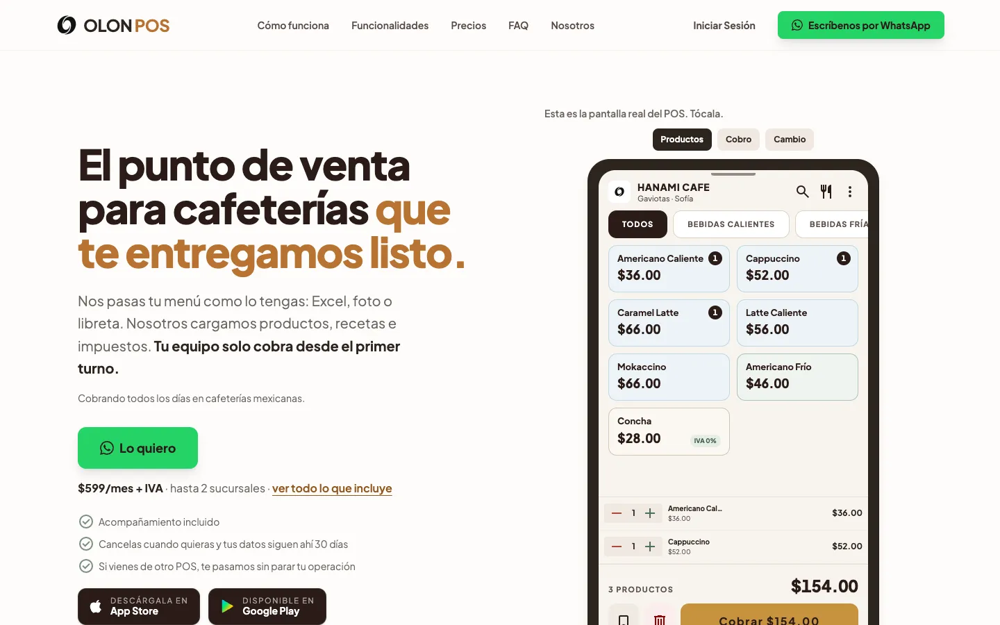
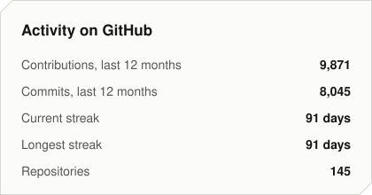
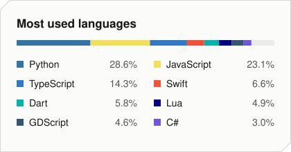
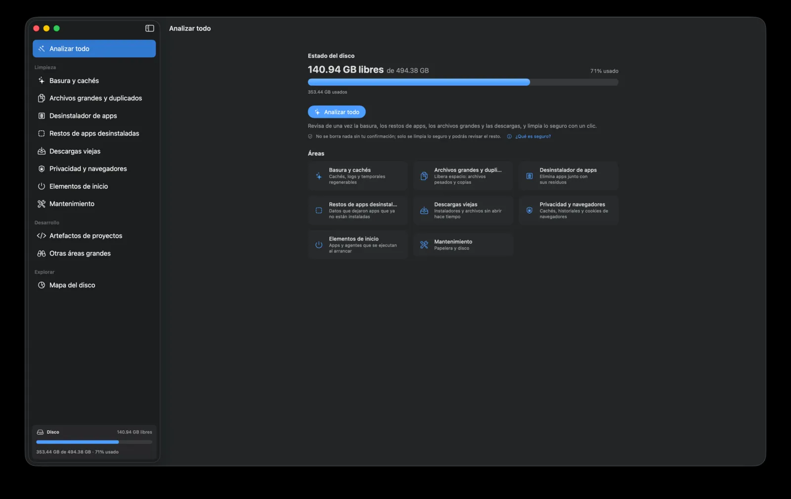
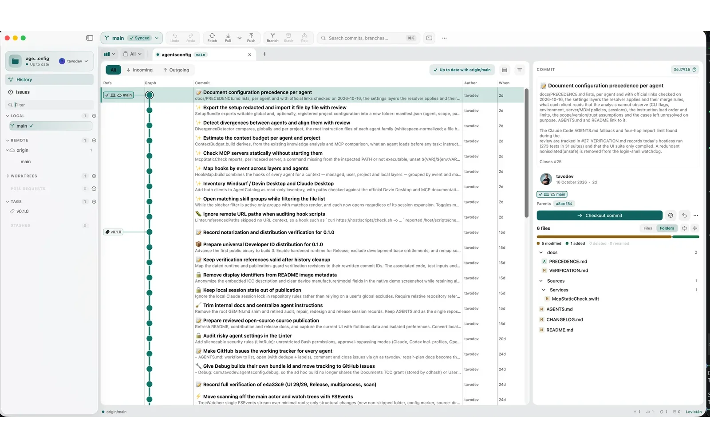
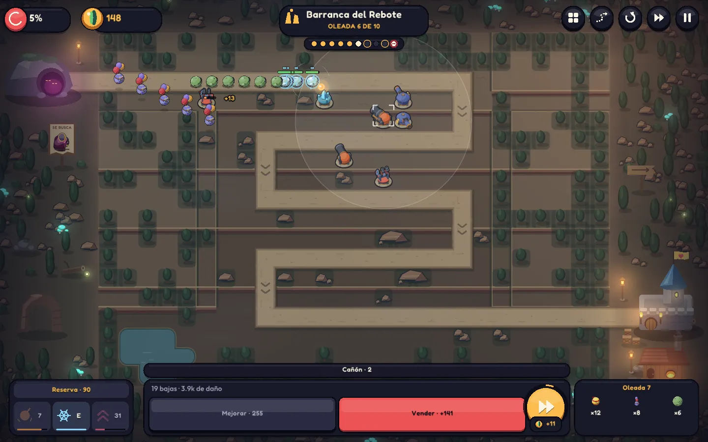
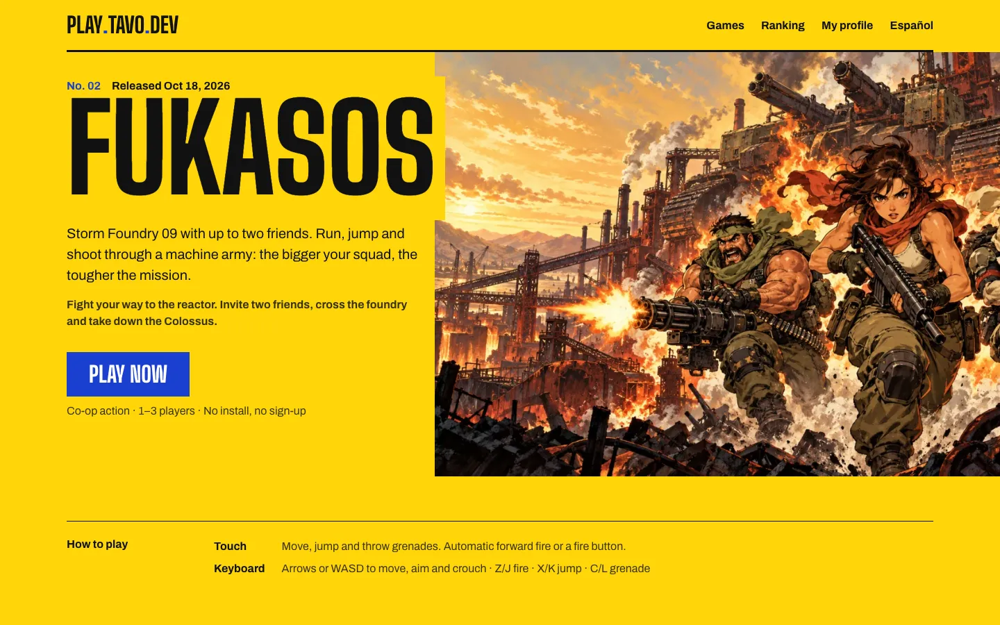
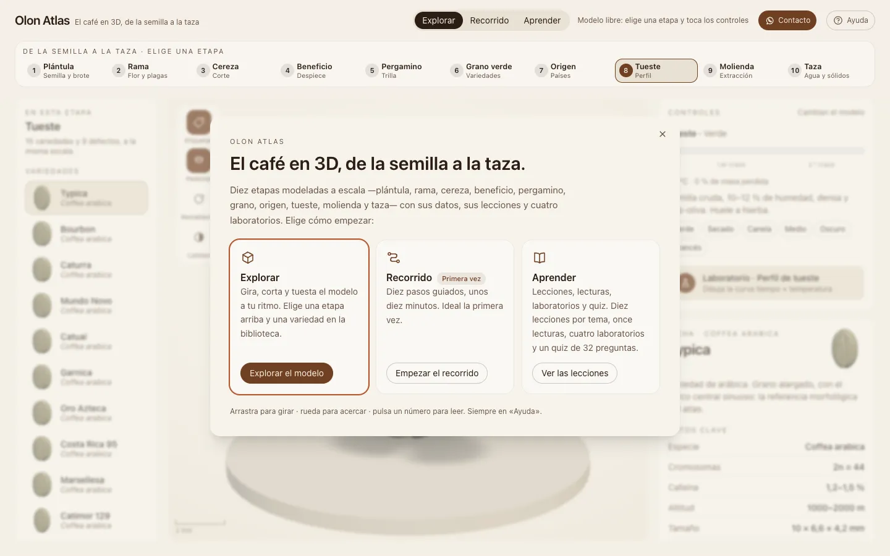
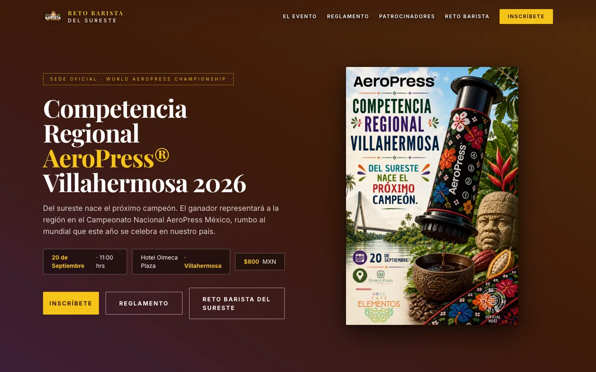
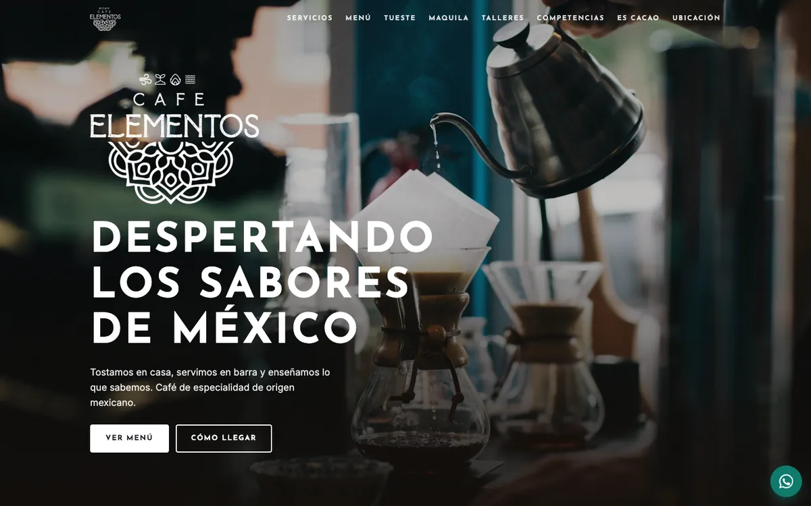

# Hi, I'm Tavo.

I'm a Forward Deployed Engineer and the founder of [OLON](https://olon.mx), a point of sale for coffee shops. I've been programming for more than ten years, and today I build with AI agents under clear rules: every project has its own architecture, instructions, permissions and tests, and nothing reaches production without review.

## What I do

### [OLON](https://olon.mx)

Founder and Forward Deployed Engineer, since 2025.

I have a coffee bar, and OLON started because I couldn't find a point of sale I liked for running it. Now it's a product for coffee shops all over Mexico. It keeps taking payments when the internet goes down, and it tells you how much you make on each drink, along with how much you sold. Every change goes through automated tests and review before it reaches the coffee shops.

### RADIUS

Full Stack Developer, since 2024, remote.

### Freelance

I build custom software for businesses, like inventory, invoicing, CRMs and websites. If your business still runs on a notebook or a spreadsheet nobody understands anymore, let's talk.

### [Hanami](https://www.instagram.com/hanamicafe_vhsa/)

My coffee bar in Villahermosa. It's where OLON gets tested before anyone else uses it, and it's the reason I now also work on tech projects for the coffee world.

## How I work

I started in 2015 writing backend code, mostly Python and Django, and I was a Tech Lead before I began working with agents. That experience is what I use now: I decide the architecture, split the work into well-scoped tasks and review every change the way I'd review one from anyone on the team.

The agents work inside a harness I set up for each project:

- Instructions with the business rules, plus my own MCP servers, so the agent looks things up instead of guessing.
- Actions no agent takes without my approval, like deploying or touching secrets. Each tool's permissions and hooks that block the attempt enforce it.
- The same rules for Claude Code and Codex.
- Automated tests and a review of every change before it ships.

[agentsconfig](https://github.com/tavodev/agentsconfig), one of my open source projects, came out of this: it's for reviewing and auditing agent configuration.

With this approach I've shipped native macOS apps in Swift, the OLON app in Flutter and games in C# and Lua. Soji, for example, shipped with 136 automated tests.

I use Claude Code and Codex every day and keep a close eye on what comes out each week. Most of it reaches me through X, which is also where I share what I try.

Tools: Claude Code, Codex, MCP, hooks, skills, Python, Django, TypeScript, Swift, Flutter, C#, Lua, PostgreSQL, Docker and AWS.

<picture>
  <source media="(prefers-color-scheme: dark)" srcset="https://skillicons.dev/icons?i=py%2Cdjango%2Cts%2Cswift%2Cflutter%2Ccs%2Clua%2Cgodot%2Cunity%2Cpostgres%2Cdocker%2Caws&theme=dark">
  
</picture>

## On GitHub

Most of my work lives in private repositories (clients, OLON and projects still in progress), so these numbers include them. They update every day.

<picture>
  <source media="(prefers-color-scheme: dark)" srcset="assets/activity-dark.svg">
  
</picture>
<picture>
  <source media="(prefers-color-scheme: dark)" srcset="assets/languages-dark.svg">
  
</picture>

<picture>
  <source media="(prefers-color-scheme: dark)" srcset="assets/snake-dark.svg">
  
</picture>

## Projects

I built all of them directing AI agents with this same approach.

### Open source

All three are native macOS apps under the MIT license.

- [wports](https://github.com/tavodev/wports): shows which ports are in use and lets you kill the process holding them. It comes with a CLI and an MCP server so agents can use it too.
- [agentsconfig](https://github.com/tavodev/agentsconfig): review and edit the settings for Claude Code, Codex, Gemini CLI and other agents in one place, both global and per project.
- [repoyo](https://github.com/tavodev/repoyo): lists your GitHub repos so you can change their visibility, archive them or delete them. It starts in simulation mode, and to actually delete a repo you have to type its full name.

### macOS apps

- [Soji](https://github.com/tavodev/soji-releases): a disk cleaner with automatic updates.
- [Leviatán](https://github.com/tavodev/leviatan-releases): a Git client.

### Games

I've made games with Raylib-cs, Godot, Unity and LÖVE.

- [Chibola](https://chibola.xyz): a tower defense game where the chibolas come rolling downhill and your guardians have to stop them. For Windows, Mac and Linux.
- [play.tavo.dev](https://play.tavo.dev): the experimental games I make with AI. They run in the browser.

And one that isn't ready yet: Japonito, an app for learning hiragana in Spanish. I'm making it because I'm learning too.

### Coffee

- [Olon Atlas](https://coffee-atlas-beta.vercel.app): a 3D coffee atlas covering what's inside the bean, varieties, roasting and origin. The 3D models are generated with code.
- [Reto Barista del Sureste](https://retobarista.olon.mx): website and sign-ups for a barista competition in Villahermosa.
- [Café Elementos](https://cafeelementos-propuestas.vercel.app): website for a coffee shop in Villahermosa.

Most of my freelance work is private, so it isn't here. If you want to know what I've done that's close to what you need, just ask.

## Experience

| Years | Company | Role |
|---|---|---|
| 2025-present | OLON | Founder and Forward Deployed Engineer |
| 2024-present | RADIUS | Full Stack Developer |
| 2024-present | Woutick! | Software Developer |
| 2022-2024 | mediQó | Tech Lead |
| 2021-2022 | Zequenze | Software Developer |

Before 2021

| Years | Company | Role |
|---|---|---|
| 2021 | IFORTAB | Python Programming Instructor |
| 2020-2021 | CINDEHU | Teacher |
| 2019-2021 | Binary System | Full Stack Developer (Django) |
| 2019-2020 | Colmena HUB | Project Manager |
| 2018-2019 | Computación y Tecnologías del Sureste | Full Stack Developer |
| 2016 | CMAIG | Web Developer (Python and Django) |
| 2015-2016 | Computación y Tecnologías del Sureste | Full Stack Developer |

## Community

I started [Dev Night Talks](https://www.meetup.com/dev-night-talks/), a weekly series of tech talks, and I organize the [AWS User Group Villahermosa](https://www.meetup.com/aws-ug-villahermosa/). Before I went all in on development I taught Python programming classes, and I still have a [YouTube channel](https://www.youtube.com/@devtavo) with tutorials, even if I haven't posted anything in a while.

## Contact

If you have a project in mind, email me at [hola@tavo.dev](mailto:hola@tavo.dev).

If you're interested in how I set up and direct agents, follow me on [X](https://x.com/tavo_dev), that's where I post the most.

I'm not looking for a job right now, but if you have an interesting offer, I'm happy to hear it.

[X](https://x.com/tavo_dev) · [Instagram](https://www.instagram.com/tavodev/) · [TikTok](https://www.tiktok.com/@devtavo) · [YouTube](https://www.youtube.com/@devtavo) · [LinkedIn](https://www.linkedin.com/in/jimenezdev/)

